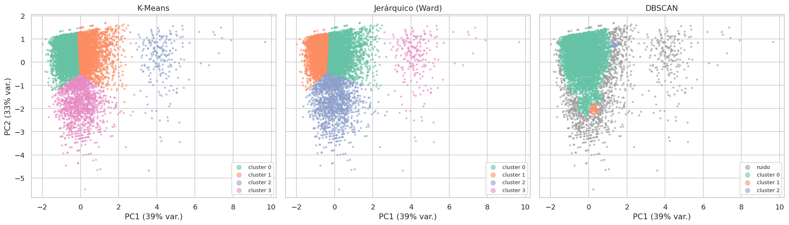
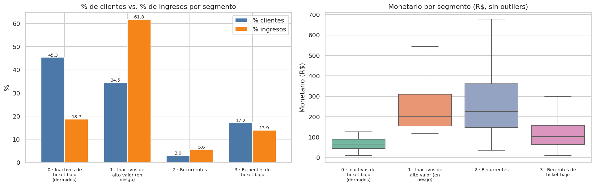
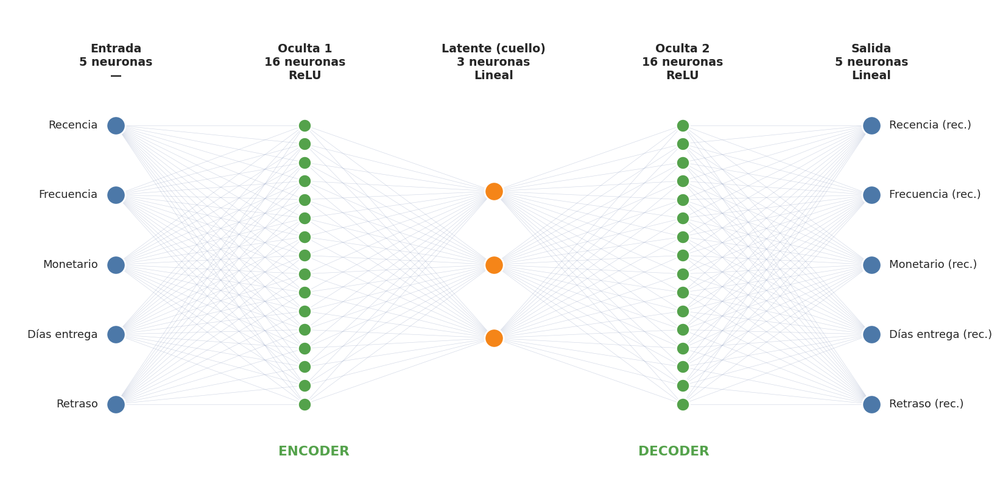
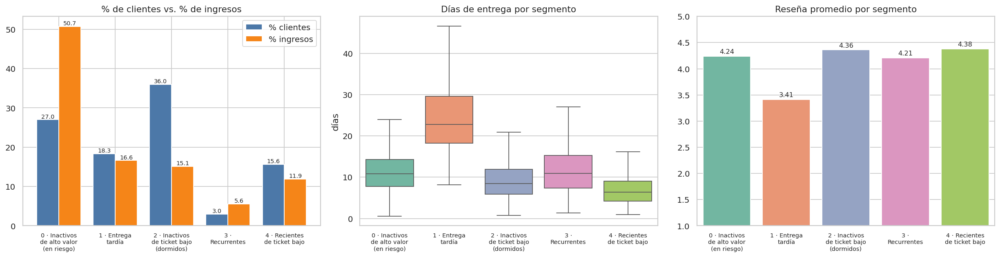

# 🛒 Segmentación de clientes de Olist con RFM y Machine Learning clásico

[](https://TU-APP.streamlit.app)


-green)

**Proyecto ACA N° 1 · Aprendizaje Automático · Especialización en Inteligencia Artificial · CUN**
**Pilar:** Ventas · **Dataset:** [Brazilian E-Commerce Public Dataset by Olist](https://www.kaggle.com/datasets/olistbr/brazilian-ecommerce)

> 🔗 **App en vivo:** `https://TU-APP.streamlit.app` · 🎥 **Video de sustentación:** `https://TU-VIDEO` *(reemplaza estos enlaces cuando los tengas)*

---

## 🎯 Objetivo y pregunta orientadora

Segmentar a los clientes de un marketplace brasileño según su comportamiento de compra (**Recencia, Frecuencia, Valor Monetario – RFM**) con tres algoritmos clásicos de clustering y presentar los resultados en una app interactiva.

> **¿Cómo transformar los datos transaccionales de ventas en segmentos de clientes accionables mediante Machine Learning clásico y presentarlos en una interfaz accesible para usuarios finales?**

## 📌 Resultados principales

**93,357 clientes reales** (`customer_unique_id`) con al menos una compra entregada y pago válido.

| Modelo | Hiperparámetros | Clusters | % ruido | Silueta ↑ | Davies-Bouldin ↓ | Calinski-Harabasz ↑ |
|---|---|---|---|---|---|---|
| **K-Means** ⭐ | k = 4 | 4 | 0 | **0.397** | 0.756 | **73,977** |
| Jerárquico (Ward) | k = 4, ajuste sobre muestra de 8,000 | 4 | 0 | 0.373 | 0.768 | 69,730 |
| DBSCAN | eps = 0.15, min_samples = 200 | 3 | 15.9 | 0.250* | 0.489* | 2,138* |

\* *DBSCAN se evalúa sin los puntos de ruido, por lo que no es estrictamente comparable con los otros dos.*

**Segmentos de K-Means (k = 4):**

| Segmento | Clientes | % clientes | Recencia media | Monetario medio | % ingresos |
|---|---|---|---|---|---|
| Inactivos de **alto valor** (en riesgo) | 32,199 | 34.5% | 272 d | R$ 296 | **61.8%** |
| Inactivos de ticket bajo (dormidos) | 42,331 | 45.3% | 287 d | R$ 68 | 18.7% |
| Recientes de ticket bajo | 16,026 | 17.2% | 41 d | R$ 134 | 13.9% |
| Recurrentes (≈2.1 órdenes) | 2,801 | 3.0% | 220 d | R$ 309 | 5.6% |

**Hallazgos clave**
- **El 97% de los clientes compró una sola vez**: la Frecuencia casi no varía, y los clusters se explican sobre todo por Recencia y Monetario.
- Los **inactivos de alto valor** son el 34% de los clientes pero generan ~62% de los ingresos: la mayor oportunidad de reactivación.
- K-Means y Ward coinciden en la estructura (evidencia de que los segmentos son robustos). DBSCAN revela que el RFM es un *continuo* sin islas de densidad: su valor es detectar clientes atípicos (~16%).

<p align="center">
  <br>
  
</p>

## 🧠 Versión 2: tiempos de entrega + redes neuronales

Se amplió el proyecto en dos frentes (notebook `02_segmentacion_redes_neuronales_autoencoder.ipynb`, módulo `src/neural.py`):

1. **Nuevas variables:** `avg_delivery_days` (días entre compra y entrega) y `avg_delay_days` (entrega real − fecha estimada; negativo = llegó antes). Hallazgo: **los clientes cuyo pedido llegó tarde dan una reseña promedio de ≈2.6, frente a ≈4.3** de quienes recibieron a tiempo o antes.
2. **Conversión a redes neuronales:** un **autoencoder 5 → 16 → 3 → 16 → 5** (296 parámetros, implementado en NumPy con retropropagación y Adam, validado con *gradient checking*) procesa RFM + entrega. Sobre su **salida reconstruida** se aplican K-Means, Ward y DBSCAN.

**Arquitectura y decisiones (todas respaldadas por experimentos en el notebook):**

| Elemento | Valor | Por qué |
|---|---|---|
| Neuronas de entrada | **5** | Una por variable: Recencia, Frecuencia, Monetario, días de entrega, retraso. Reseñas y cuotas quedan fuera para usarlas como validación independiente |
| Capas ocultas | **16 + 16**, ReLU | No linealidad que no se satura; con 16 el error de reconstrucción deja de mejorar de forma apreciable (8 es claramente peor, 32 mejora poco) |
| Capa latente | **3**, lineal | Conserva ≈95% de la información (PCA con 3 componentes: ≈74%) y se visualiza en 3D |
| Neuronas de salida | **5**, lineal | Reconstruyen las 5 entradas; son el espacio que se agrupa. Las variables estandarizadas no tienen tope, por lo que sigmoide no sirve |
| Pérdida / optimizador | MSE / Adam (lr 0.003, lote 256) | Regresión de variables continuas |
| Épocas | **máx. 300 con parada temprana** (paciencia 10, 10% de validación) | El error de validación decide cuándo parar; en la práctica converge entre ≈75 y ≈150 épocas (≈8 s) |

**Resultados (espacio común de 5 variables):**

| Modelo | Clusters | % ruido | Silueta ↑ | Davies-Bouldin ↓ | Calinski-Harabasz ↑ |
|---|---|---|---|---|---|
| Red + K-Means (k=5) | 5 | 0 | 0.240 | 1.167 | 30,649 |
| Red + Ward (k=5) | 5 | 0 | 0.223 | 1.173 | 29,139 |
| Red + DBSCAN (eps 0.4, min_samples 100)* | 5 | 13.4 | 0.103 | 0.855 | 2,082 |
| *Clásico: K-Means directo, 5 variables (k=5)* | 5 | 0 | 0.244 | 1.159 | 30,932 |

\* DBSCAN se evalúa sin ruido (no comparable). **En estos datos la red neuronal no mejora la segmentación clásica: la confirma** (ARI 0.91 entre K-Means con red y K-Means directo). El aporte real son los tiempos de entrega y el estudio de estabilidad.

**Segmentos (red + K-Means, k=5):**

| Segmento | % clientes | Días de entrega | Reseña | % ingresos |
|---|---|---|---|---|
| Inactivos de alto valor (en riesgo) | 27.0% | 11.5 | 4.24 | **50.7%** |
| **Entrega tardía** (llegan después de lo prometido) | 18.3% | 25.9 | **3.41** | 16.6% |
| Inactivos de ticket bajo (dormidos) | 36.0% | 9.1 | 4.36 | 15.1% |
| Recientes de ticket bajo | 15.6% | 7.0 | 4.38 | 11.9% |
| Recurrentes | 3.0% | 12.3 | 4.21 | 5.6% |

**⚠️ Hallazgo de rigor — estabilidad.** Agrupar el **espacio latente** (3 neuronas) parece lo natural, pero es **inestable**: al reentrenar la red con otra semilla, las particiones casi no coinciden (ARI medio ≈ 0.18). Agrupar la **salida** de la red es estable (ARI ≈ 0.85 entre semillas, ≈ 0.91 frente al K-Means clásico; el K-Means clásico bajo remuestreo: ≈ 0.97). Por eso el proyecto agrupa la salida y usa el latente solo para visualizar. Los tamaños de los segmentos pueden variar unos puntos entre ejecuciones; la estructura se mantiene.

<p align="center"><br>
</p>

## 🤗 Extra: clasificación de reseñas con Transformers (Hugging Face)

`notebooks/03_clasificacion_resenas_transformers.ipynb` clasifica el **sentimiento de las reseñas** de Olist (portugués) con *fine-tuning* de un Transformer. Modelo recomendado: **`neuralmind/bert-base-portuguese-cased`** (BERTimbau base). Incluye una **línea base clásica** (TF-IDF + regresión logística: macro-F1 ≈ 0.92 en 2 clases y ≈ 0.66 en 3 clases) para saber si el transformer realmente aporta.

> Las celdas de Hugging Face **no se ejecutaron** en el entorno donde se generó el notebook (sin GPU ni internet); están pensadas para **Google Colab con GPU**. Dependencias: `pip install -r requirements-nlp.txt`.

## 🗂 Estructura del repositorio

```
olist-customer-segmentation/
├── app.py                      # App de Streamlit (interfaz)
├── requirements.txt            # Dependencias
├── notebooks/
│   ├── 01_segmentacion_clientes_rfm.ipynb   # v1 clásico: EDA → RFM → modelos → evaluación (con salidas)
│   ├── 02_segmentacion_redes_neuronales_autoencoder.ipynb   # v2: tiempos de entrega + autoencoder (con salidas)
│   └── 03_clasificacion_resenas_transformers.ipynb          # extra: sentimiento de reseñas con Hugging Face (Colab)
├── src/
│   ├── data_prep.py            # Integración de tablas, RFM y tiempos de entrega
│   ├── modeling.py             # Escalado, K-Means / Ward / DBSCAN, métricas, perfilamiento
│   └── neural.py               # Autoencoder en NumPy (backprop + Adam), transformador de variables
├── scripts/
│   └── run_pipeline.py         # Reproduce todo (clásico + red neuronal) desde la línea de comandos
├── data/
│   ├── raw/                    # (vacío) aquí van los CSV de Kaggle — NO se versionan
│   └── processed/customers_rfm.csv   # Tabla RFM lista (la usa la app)
├── models/                     # Scaler, modelos clásicos (joblib) y pesos del autoencoder (autoencoder.npz)
├── reports/                    # Métricas, perfil de segmentos y figuras
├── tests/                      # Pruebas: RFM, modelos, gradient checking del autoencoder
└── .streamlit/config.toml
```

## 🚀 Cómo ejecutarlo

### Opción A — Solo la app (lo más rápido)
La app usa `data/processed/customers_rfm.csv`, que ya viene en el repo.

```bash
git clone https://github.com/<tu-usuario>/olist-customer-segmentation.git
cd olist-customer-segmentation

python -m venv .venv
source .venv/bin/activate          # Windows: .venv\Scripts\activate
pip install -r requirements.txt

streamlit run app.py               # se abre en http://localhost:8501
```

### Opción B — Reproducir el análisis completo desde los datos crudos
1. Descarga el dataset de [Kaggle](https://www.kaggle.com/datasets/olistbr/brazilian-ecommerce) y coloca los 9 CSV en `data/raw/` (ver `data/raw/README.md`).
2. Elige una de las dos rutas:
   ```bash
   # (1) Notebook interactivo
   pip install jupyterlab
   jupyter lab notebooks/01_segmentacion_clientes_rfm.ipynb   # luego el 02 (requiere la tabla generada por el 01)

   # (2) Línea de comandos (genera la tabla RFM + entrega, entrena el autoencoder, métricas y modelos; ≈1–2 min)
   python scripts/run_pipeline.py                      # lee data/raw/
   python scripts/run_pipeline.py --raw-dir <carpeta>  # otra ubicación
   ```
3. Pruebas (opcional): `pip install pytest && pytest -q`

> 💡 **Google Colab:** sube el repo (o clónalo con `!git clone ...`), ejecuta `!pip install -r requirements.txt` y abre el notebook. Los CSV pueden ir en `data/raw/`.

## ☁️ Despliegue en GitHub + Streamlit Community Cloud

1. **Crea el repositorio en GitHub** (vacío, sin README) y sube el proyecto:
   ```bash
   git init
   git add .
   git commit -m "Proyecto ACA1: segmentación de clientes Olist (RFM + clustering)"
   git branch -M main
   git remote add origin https://github.com/<tu-usuario>/olist-customer-segmentation.git
   git push -u origin main
   ```
   Los CSV crudos **no se suben** (`.gitignore`); `data/processed/customers_rfm.csv` (~6.5 MB) **sí**, y es lo único que la app necesita.
2. Entra a <https://share.streamlit.io> con tu cuenta de GitHub → **Create app** → elige el repo, rama `main` y archivo principal `app.py`.
3. En **Advanced settings** selecciona **Python 3.11 o 3.12** → **Deploy**. En 2–3 minutos tendrás una URL pública `https://<nombre>.streamlit.app`.
4. Pega esa URL en este README (badge y encabezado) y en el póster.

## 🖥 Funcionalidades de la app

| Pestaña | Qué permite |
|---|---|
| 📊 Resumen | KPIs, métricas del modelo (Silueta, Davies-Bouldin, Calinski-Harabasz; con red neuronal también en el espacio original) y % de clientes vs. % de ingresos |
| 🧊 Visualización | Dispersión 3D (R-F-M), 2D con ejes a elección (incluye entrega), PCA y espacio latente 3D (red); filtros por estado |
| 🧾 Perfil de segmentos | Tabla de perfil, boxplots por variable, categorías favoritas y acciones de marketing sugeridas |
| ⚖️ Comparar modelos | Los 3 algoritmos lado a lado + barrido de *k* para K-Means/Ward |
| 🧠 Red neuronal | Arquitectura, curva de aprendizaje, épocas y justificación de cada decisión de la red |
| 🔮 Simulador | Ingresas R, F, M (y entrega, con la red) de un cliente y el modelo elegido le asigna un segmento |
| ℹ️ Acerca de | Metodología y descarga de los clientes segmentados en CSV |

En la barra lateral se elige el **enfoque** (Clásico · Red neuronal), el modelo (K-Means · Jerárquico Ward · DBSCAN) y sus hiperparámetros; el modelo se re-entrena en segundos y queda en caché. El enfoque con red usa los pesos guardados en `models/autoencoder.npz` (si faltan, reentrena en ≈10 s).

## 🔬 Metodología

| Decisión | Justificación |
|---|---|
| Unidad = `customer_unique_id` | `customer_id` cambia en cada orden (99,441 ids → 96,096 personas reales) |
| Solo órdenes `delivered` con pago > 0 | Ventas efectivamente concretadas |
| Monetario = Σ `payment_value` por orden y luego por cliente | Una orden puede tener varios pagos (cuotas, vouchers) |
| Recencia = días desde la última compra hasta (última fecha del dataset + 1) | Fecha de corte reproducible |
| `log1p` + `StandardScaler` | Reduce asimetría (Monetario: 9.2 → 0.5) y evita que R$ domine las distancias. Una ablación mostró que aplicar log también a Recencia rinde ligeramente mejor (silueta 0.397 vs. 0.370) |
| k = 4 (K-Means y Ward) | k=2 maximiza silueta (0.71) pero solo aísla al 3% recurrente (poco accionable); k=4 maximiza Calinski-Harabasz y tiene el menor Davies-Bouldin entre k ≥ 3 |
| DBSCAN eps = 0.15, min_samples = 200 | Curva k-distance + pequeña búsqueda de hiperparámetros (otras combinaciones colapsan en 1 cluster o generan >18% de ruido) |
| Ward y DBSCAN (en la app) con muestra | Memoria ~n²: se ajusta con muestra y el resto se asigna al centroide / core point más cercano |

**Tablas utilizadas:** `customers`, `orders`, `order_payments` (RFM) y `order_items`, `products`, `category_translation`, `order_reviews` (perfilamiento: categoría favorita y reseña). **No se usan:** `sellers` (describe vendedores, no clientes) y `geolocation` (posible extensión: mapa de segmentos).

**¿Cómo leer las métricas?**
- **Silueta** (−1 a 1): qué tan bien encaja cada cliente en su segmento frente al vecino más cercano. >0.5 buena · 0.25–0.5 aceptable · <0.25 débil.
- **Davies-Bouldin** (≥ 0): solapamiento entre segmentos; menor es mejor.
- **Calinski-Harabasz**: razón entre separación entre-segmentos y compacidad interna; mayor es mejor.

## ⚠️ Limitaciones

- **Red neuronal:** es muy sensible a la semilla (por eso se agrupa su salida y no su latente); los tamaños de los segmentos pueden variar unos puntos. No supera al K-Means clásico en estas 5 variables; para ganar valor habría que ampliar el espacio de variables.
- Con 97% de compradores de una sola vez, la Frecuencia aporta poca variabilidad; silueta ≈ 0.40 indica fronteras difusas entre segmentos.
- La caída de órdenes después de ago-2018 es el **corte del dataset**, no una caída real del negocio.
- Los nombres de segmentos se asignan con reglas simples sobre el perfil promedio; deben validarse con criterio de negocio.
- Los ids de cluster pueden variar con la versión de scikit-learn (por eso se referencian por nombre).

## 🔭 Trabajo futuro
Añadir más variables (categoría, medio de pago, reseñas) al clustering, comparar con un autoencoder en PyTorch/Keras (el notebook 02 incluye el código equivalente), probar Gaussian Mixture, usar `geolocation` para análisis geográfico y validar la estabilidad de los segmentos en el tiempo.

## 📚 Referencias

- Olist. (2018). *Brazilian E-Commerce Public Dataset by Olist* [Conjunto de datos]. Kaggle. https://www.kaggle.com/datasets/olistbr/brazilian-ecommerce
- Pedregosa, F., Varoquaux, G., Gramfort, A., Michel, V., Thirion, B., Grisel, O., … Duchesnay, É. (2011). Scikit-learn: Machine learning in Python. *Journal of Machine Learning Research, 12*, 2825–2830.

## 📄 Licencia
Código bajo licencia MIT (ver `LICENSE`). Los datos pertenecen a Olist; consulta los términos de uso en la página del dataset en Kaggle.
